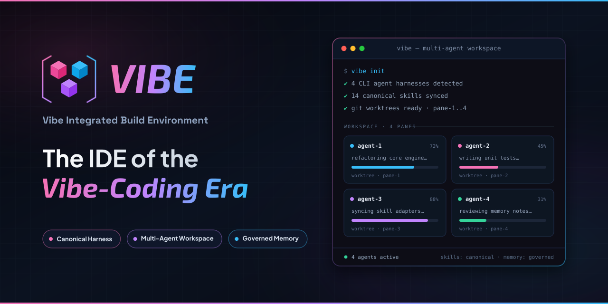

<div align="center">



[](docs/product/roadmap.md)
[](LICENSE)
[](docs/index.md)

**[Why VIBE](#why-vibe)** ·
**[Planned experience](#planned-experience)** ·
**[What's here today](#whats-in-this-repository-today)** ·
**[Installing skills](#installing-skills)** ·
**[Roadmap](#roadmap)** ·
**[Docs](#documentation)**

</div>

<br />

> **Status: pre-alpha.** The `vibe` CLI and local web app are not implemented
> yet. This repository currently holds the canonical harness content and the
> project's documentation foundation.

## Why VIBE

Agent-assisted development is fragmented three ways — VIBE addresses all
three with one canonical content source compiled through adapters, a
multi-pane local workspace with per-pane Git worktrees, and a reviewed
learning loop:

| Fragmented today                                                                                                       | VIBE's answer                                                                |
| ---------------------------------------------------------------------------------------------------------------------- | ---------------------------------------------------------------------------- |
| **Harness configuration** duplicated by hand per platform (Claude Code, Codex, Gemini CLI, Cursor…) and drifting apart | One canonical content source, compiled through adapters per platform         |
| **Parallel workspaces** — juggling terminals, branch collisions, manual worktree management                            | A multi-pane local workspace with per-pane Git worktrees                     |
| **Learned context** that evaporates at the end of a session instead of becoming a team asset                           | A reviewed learning loop — only approved instincts load into future sessions |

Full direction: [docs/product/DESIGN.md](docs/product/DESIGN.md).

## Planned experience

All three surfaces are **planned**, not yet built:

| Surface                     | What it'll do                                                                  |
| --------------------------- | ------------------------------------------------------------------------------ |
| 🧭 **Harness Setup wizard** | Scan a repo, suggest rules/skills/agents, apply                                |
| 🪟 **Workspace**            | Multi-pane terminal layout with saveable templates and per-pane Git worktrees  |
| 🧠 **Learning tab**         | Review session-derived instincts; only approved ones load into future sessions |

## What's in this repository today

| Area                                                   | Details                                                                                                                                                                                                                                                                                                                                                                                                                |
| ------------------------------------------------------ | ---------------------------------------------------------------------------------------------------------------------------------------------------------------------------------------------------------------------------------------------------------------------------------------------------------------------------------------------------------------------------------------------------------------------- |
| **Skills** — canonical source under [skills/](skills/) | [brainstorming](skills/brainstorming/) — turn a vague idea into a validated design brief through structured dialogue before code · [coding-style](skills/coding-style/) — coding-style discipline applying the rule packs while writing, reviewing, and setting up gates · [debugging](skills/debugging/) — systematic debugging and root-cause analysis: reproduce → evidence → one hypothesis → fix the cause → verify fresh · [docs-architect](skills/docs-architect/) — spec + documentation system for a repo end-to-end · [git-workflow](skills/git-workflow/) — safe Git/GitHub workflows for coding agents · [parallel-agents](skills/parallel-agents/) — orchestrate work across parallel subagents · [prompt-guru](skills/prompt-guru/) — create and optimize prompts at both the system and user layer per official provider guidance · [research](skills/research/) — disciplined multi-source research with cited, verified synthesis · [security-audit](skills/security-audit/) — vulnerability review with FP discipline + live malicious-package vetting (OSV `MAL-`) · [tdd](skills/tdd/) — test-driven development discipline for coding agents |
| **Rules** — canonical source under [rules/](rules/)   | Always-on rule packs ([ADR 0007](docs/decisions/0007-adopt-claude-native-rule-packs.md)): [common](rules/common/) · [typescript](rules/typescript/) · [python](rules/python/) · [shell](rules/shell/) — the thin "what" layer (coding-style, security, agent-behavior); the deep "how" for the first two lives in the companion [coding-style](skills/coding-style/) and [security-audit](skills/security-audit/) skills                                                                                                                       |
| **Agents** — canonical source under [agents/](agents/) | Predefined research subagents split by modality ([ADR 0006](docs/decisions/0006-predefine-research-agents-by-modality.md)): [web-researcher](agents/research/web-researcher.md) · [academic-researcher](agents/research/academic-researcher.md) · [code-researcher](agents/research/code-researcher.md) · [fact-checker](agents/research/fact-checker.md) — plus [security-reviewer](agents/security/security-reviewer.md), an adversarial review lane ([ADR 0008](docs/decisions/0008-adopt-a-layered-security-harness.md))                                                                 |
| **Hooks** — canonical source under [hooks/](hooks/)   | Fail-closed security enforcement ([ADR 0008](docs/decisions/0008-adopt-a-layered-security-harness.md)): dangerous-command blocker · secret protection (path + written content) · install-time [dependency gate](hooks/security/dependency-gate.py) that denies OSV `MAL-` versions — see [hooks/security/README.md](hooks/security/README.md)                                                                 |
| **Documentation foundation**                           | Product direction, ADRs, and agent routing — see [docs/index.md](docs/index.md)                                                                                                                                                                                                                                                                                                                                        |
| **Spec Kit**                                           | [GitHub Spec Kit](https://github.com/github/spec-kit) initialized for spec-driven feature work (`.specify/`)                                                                                                                                                                                                                                                                                                           |

## Installing skills

Skills can be installed straight from this repo with
[`npx skills`](https://github.com/vercel-labs/skills) — no clone needed:

```bash
npx skills add https://github.com/timezlab/vibe/tree/main/skills
```

This scans [skills/](skills/) and lets you pick which ones to install into
your agent's config (Claude Code, Cursor, Codex, and others). To grab a
single skill without the picker, add `--skill <name>`:

```bash
npx skills add https://github.com/timezlab/vibe/tree/main/skills --skill coding-style
```

> The short `owner/repo` form (`npx skills add timezlab/vibe`) works too,
> but scans the whole repo — including the `.claude/skills` symlinks — so
> the `tree/main/skills` URL above is the shortest link that targets the
> canonical source cleanly.

## Roadmap

| Phase       | Summary                                                                                            |
| ----------- | -------------------------------------------------------------------------------------------------- |
| 1 — current | Harness foundation: canonical rules/agents/commands/hooks + `vibe sync` spec (Claude target first) |
| 2           | App core: local server, xterm.js panes, Dockview layouts                                           |
| 3           | Setup wizard + Learning tab                                                                        |
| 4           | Broadcast prompts, pane status, Git panel, cost/metrics                                            |

Details and open decision gates: [docs/product/roadmap.md](docs/product/roadmap.md).

## Contributing

See [CONTRIBUTING.md](CONTRIBUTING.md). Documentation changes ship in the
same PR as the code they describe.

## Documentation

- [docs/index.md](docs/index.md) — map of all documentation
- [ARCHITECTURE.md](ARCHITECTURE.md) — module map and dependency invariants
- [docs/product/DESIGN.md](docs/product/DESIGN.md) — product direction

## License

[MIT](LICENSE)

<div align="center">

<br />

<br />
<sub>Built in the open, one canonical source at a time.</sub>

</div>
